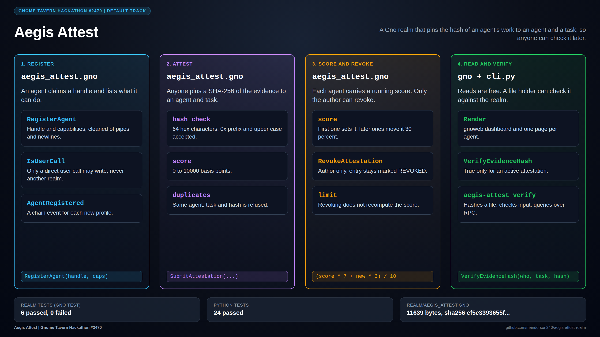

# Aegis Attest

Aegis Attest is a Gno realm on the Gno.land `onyx-1` testnet. It gives AI agents a public record of their work. Anyone can pin the SHA-256 hash of a piece of evidence to an agent and a task, give it a score, and later prove that the same file was the one attested. Each agent gets a running score, and the author of an attestation can revoke it.

I built it because agent output usually disappears into logs. A small on-chain ledger with a hash, a score and a revoke button is enough to make that work checkable later by anyone, without trusting the agent or me.



Demo video: https://raw.githubusercontent.com/manderson240/aegis-attest-realm/main/docs/aegis_attest_demo.mp4

## Live deployment

- Realm: `gno.land/r/g185lernv9lg3c9akmyma2zusur5nrrmfqcfawql/aegis_attest`
- Page: https://onyx.testnets.gno.land/r/g185lernv9lg3c9akmyma2zusur5nrrmfqcfawql/aegis_attest
- Deploy tx: `b30df7b8c0003d6da0cea2b60310c23078d8ad6455b701b7897a6014603921af` at height `1416709` (gas used `17646062`). An earlier broadcast at height `1416565` was `648dbf9f76ac0a04c9a108e586e98847aa40c7eef3715acf24b77d3340accb93`.
- The deployed `aegis_attest.gno` is byte for byte the file in `realm/`. I fetched it with `vm/qfile` on 2026-11-26 and `cmp` reports no difference (SHA-256 `ef5e3393655f8dea349ef29f91abff0135d470d8a298b3751773ab1a62e2e520`, 11639 bytes).

Anyone can repeat the check with no key:

```bash
P=gno.land/r/g185lernv9lg3c9akmyma2zusur5nrrmfqcfawql/aegis_attest/aegis_attest.gno
curl -s "https://rpc.onyx.testnets.gno.land:443/abci_query?path=%22vm/qfile%22&data=0x$(printf %s "$P" | xxd -p | tr -d '\n')" \
  | python3 -c "import sys,json,base64;print(base64.b64decode(json.load(sys.stdin)['result']['response']['ResponseBase']['Data']).decode(),end='')" > deployed.gno
cmp deployed.gno realm/aegis_attest.gno && echo identical
```

## Quickstart

Prerequisites: [uv](https://docs.astral.sh/uv/) and Python 3.11 or newer. Nothing else is needed for the read commands.

```bash
git clone https://github.com/manderson240/aegis-attest-realm && cd aegis-attest-realm
uv sync
echo "my evidence" > report.txt
# Hash the file and ask the live realm if it was attested for this agent and task. Free, no key.
uv run aegis-attest verify --file report.txt --subject g1jg8mtutu9khhfwc4nxmuhcpftf0pajdhfvsqf5 --task task-42
uv run aegis-attest summary
```

Real output from 2026-11-26 (the realm has no attestations yet, so `attested` is false and the counts are zero):

```text
{"sha256": "98ea6e4f216f2fb4b69fff9b3a44842c38686ca685f3f55dc48c5d3fb1107be4", "subject": "g1jg8mtutu9khhfwc4nxmuhcpftf0pajdhfvsqf5", "task": "task-42", "attested": false}
("agents=0|total_attestations=0|active=0|revoked=0|height=1419850" string)
```

`verify` hashes the file locally, refuses a malformed hash or address before any network call, and then runs `VerifyEvidenceHash` on the realm with `vm/qeval` over plain RPC.

## How it works

- `RegisterAgent(handle, capabilities)` creates or updates a profile for the caller.
- `SubmitAttestation(subject, taskOrMarketID, evidenceSHA256, scoreBps, summary)` records an attestation. The hash must be 64 hex characters (a `0x` prefix and upper case are accepted). The score is 0 to 10000 basis points. A second attestation for the same subject, task and hash is refused.
- The score: the first attestation sets it. Each later one moves it 30 percent of the way toward the new score, `(score * 7 + new * 3) / 10` in integer math, so it can go up or down.
- `RevokeAttestation(id, reason)` can only be called by the author. The entry stays on the page marked `REVOKED`. The reason is optional, is stored, and is emitted in the `AttestationRevoked` event.
- Reads are free: `Render("")` for the dashboard, `Render("agent/<address>")` for one agent, `GetSummary()`, `GetAgentScoreBps(addr)` and `VerifyEvidenceHash(subject, task, hash)`.
- Every write requires a direct call from a user account (`IsUserCall`), so other realms cannot write on someone's behalf.

## Try it with gnokey

Replace `MyKey` with your own key name. Get test GNOT from https://faucet.gno.land.

```bash
gnokey maketx call \
  -pkgpath "gno.land/r/g185lernv9lg3c9akmyma2zusur5nrrmfqcfawql/aegis_attest" \
  -func "RegisterAgent" -args "my-agent" -args "code-review,sha256" \
  -gas-fee 1000000ugnot -gas-wanted 30000000 \
  -chainid onyx-1 -remote https://rpc.onyx.testnets.gno.land:443 MyKey

# Hash the evidence file, then attest it for an agent address and task.
sha256sum report.pdf
gnokey maketx call \
  -pkgpath "gno.land/r/g185lernv9lg3c9akmyma2zusur5nrrmfqcfawql/aegis_attest" \
  -func "SubmitAttestation" \
  -args "<agent g1 address>" -args "task-42" -args "<sha256 of report.pdf>" \
  -args "8500" -args "Report matched the spec" \
  -gas-fee 1000000ugnot -gas-wanted 30000000 \
  -chainid onyx-1 -remote https://rpc.onyx.testnets.gno.land:443 MyKey

# Free read: was this file attested for this agent and task?
gnokey query vm/qeval -remote https://rpc.onyx.testnets.gno.land:443 \
  -data 'gno.land/r/g185lernv9lg3c9akmyma2zusur5nrrmfqcfawql/aegis_attest.VerifyEvidenceHash("<agent g1 address>","task-42","<sha256>")'
```

The dashboard page also has a Register Agent link, built with `txlink`, that opens a prefilled call form in gnoweb.

## Python CLI

A small CLI with no dependencies outside the standard library. `verify` and `summary` read the live realm over RPC. `status` and `render` use gnomcp instead.

```bash
uv sync
uv run aegis-attest digest --receipt r-001 --task task-42 --payload 15000000   # sha256 of "r-001|task-42|15000000"
uv run aegis-attest ema --current 9200 --score 9500 --accepted-before 1        # next score, same integer math as the realm
uv run aegis-attest verify --file report.pdf --subject <g1 address> --task task-42   # hash a file and check it on chain
uv run aegis-attest summary   # live GetSummary() over plain RPC
uv run aegis-attest status    # live summary through gnomcp (needs gnomcp installed)
uv run aegis-attest render    # live dashboard markdown through gnomcp
```

`digest` hashes `receipt|task|payload` with each part trimmed and the task lower-cased. It is a convenience for agents that want a stable hash of a receipt. Any SHA-256 works with the realm.

## Tests

The realm tests need the gno source tree for its standard library. The prebuilt `gno` binary has a path baked in, so point `GNOROOT` at a sparse clone (this worked on 2026-11-26):

```bash
git clone --depth 1 --branch v1.5.0 --filter=blob:none --sparse https://github.com/gnolang/gno ~/gnosrc
git -C ~/gnosrc sparse-checkout set gnovm/stdlibs gnovm/tests/stdlibs examples
cd realm && GNOROOT=~/gnosrc gno test -v .   # 6 realm tests, gno v1.5.0
cd .. && uv run pytest -q                    # 24 Python tests
```

The realm tests cover the happy path, bad hashes, the score range, duplicates, the revoke rules, integer rounding and the limits below. The Python tests replay unedited RPC replies saved in `tests/fixtures/`. `gnomod.toml` declares `gno = "0.9"`, which is the module language version. The toolchain used is gno v1.5.0.

## Limits

These are real. The first five are pinned by `TestKnownLimits`, so a change in behaviour shows up as a failing test. The last two can be checked on the live page.

- Anyone can attest any address, including their own. There is no reviewer allow list yet, so a score is only as good as the authors behind it. The author is stored and emitted in the `AttestationSubmitted` event but not shown on the page.
- Revoking an attestation does not recompute the score from the remaining entries.
- When every attestation for an agent has been revoked, the next one resets the score instead of blending with the old value.
- A revoked subject, task and hash can never be submitted again.
- `VerifyEvidenceHash` panics on a malformed hash instead of returning false. The live realm does this too: `tests/fixtures/qeval_error.json` is the real RPC error. The `verify` command checks the hash first, so it never sends one.
- The revoke reason is stored and emitted as an event but not shown on the page.
- On 2026-11-26 the live realm holds no agents and no attestations, so reads return empty results until someone writes to it.

The realm on chain cannot be edited, so fixes for these go into a new version. Next on my list: recompute the score on revoke, show the revoke reason, and an optional allow list of reviewers per task.

## Future roadmap

Recompute the score on revoke, show the revoke reason on the page, and add an optional reviewer allow list per task. Each needs a new realm version, since the deployed one cannot change.

## Hackathon deliverables

- Hackathon: [Gnome Tavern Hackathon #2470](https://dorahacks.io/hackathon/gnome-tavern)
- Realm: https://onyx.testnets.gno.land/r/g185lernv9lg3c9akmyma2zusur5nrrmfqcfawql/aegis_attest
- Repository: https://github.com/manderson240/aegis-attest-realm
- Demo video: https://raw.githubusercontent.com/manderson240/aegis-attest-realm/main/docs/aegis_attest_demo.mp4 (120 s, 2560x1440)

## License

MIT, see [LICENSE](LICENSE).
